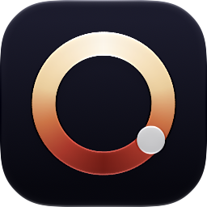
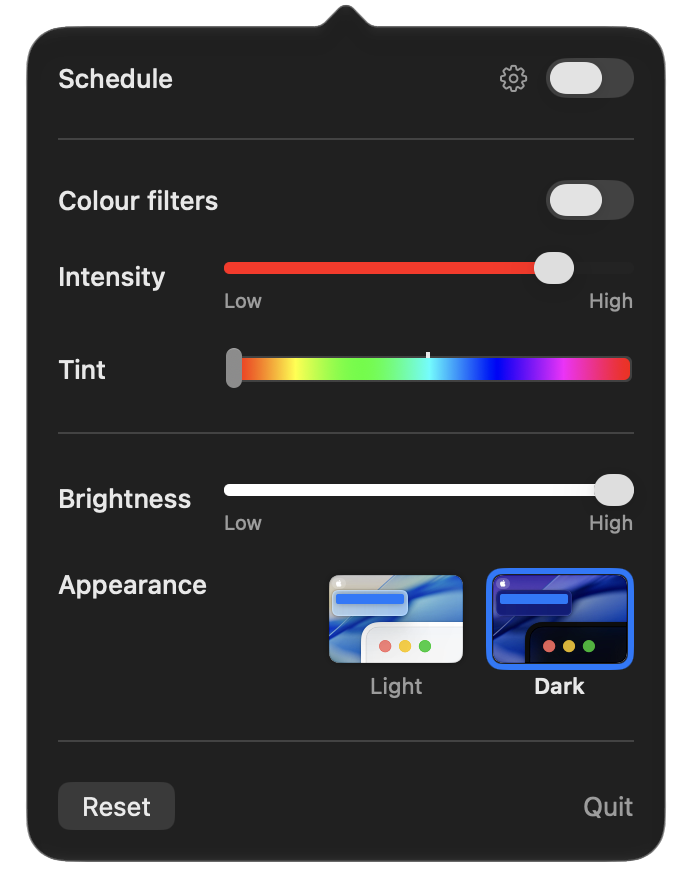
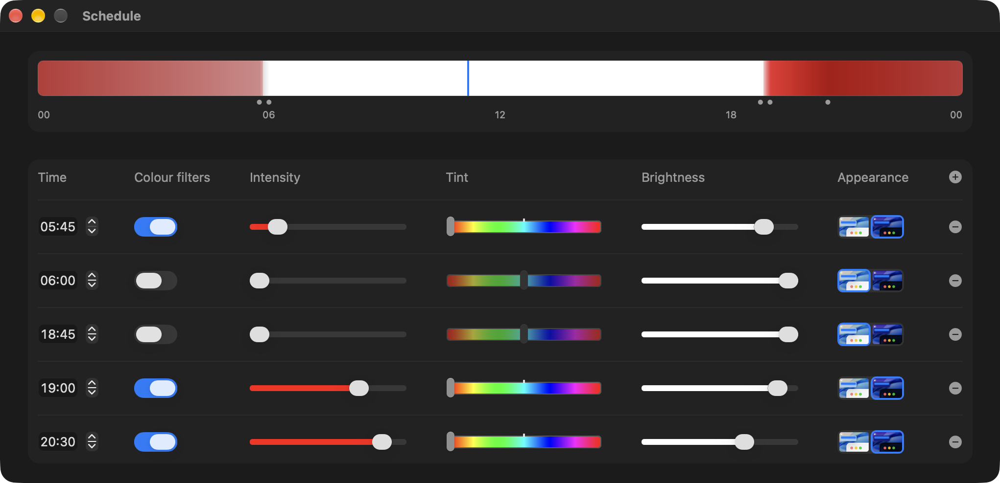

<p align="center">
  
</p>

# Safelight

Safelight puts your Mac's color filter, brightness and Light/Dark appearance on one schedule. Choose how the screen should look at a few times of day, and Safelight fades from one to the next: plain white through the afternoon, warmer and dimmer after sunset, deep red late at night, and back again in the morning.

It lives in the menu bar.

<p align="center">
  
</p>

## What it does

- **A red that goes all the way.** Safelight drives the Color Tint filter built into macOS (System Settings › Accessibility › Display › Color Filters), so the screen can go fully red, which Night Shift can't. The filter applies to everything on screen.
- **Brightness for every display.** Displays that let the Mac set their brightness are set directly. The rest, like most external monitors, are dimmed in software.
- **Light and Dark too.** Each time of day can switch the system between Light and Dark appearance.
- **One schedule for all of it.** Add as many times of day as you like. Each sets the color filter, intensity, tint, brightness and appearance, and the filter and brightness fade smoothly between them. The strip along the top previews the whole day.
- **Looks and speaks like macOS.** The controls are the ones System Settings uses, and every label comes from System Settings' own translations, so Safelight appears in your Mac's language.

<p align="center">
  
</p>

Click the menu bar icon for the controls, and the gear next to Schedule to edit the schedule. Right-click (or Control-click) the icon for Open at Login and Quit. Reset and Quit turn the schedule and color filter off and set brightness back to full.

## Install

Safelight needs macOS 15.5 or later, on Apple silicon or Intel.

1. Download the Safelight disk image (`.dmg`) from the [latest release](https://github.com/MorusPatre/Safelight/releases/latest), open it, and drag Safelight onto the Applications folder beside it.
2. Open Safelight. It isn't notarized by Apple, so macOS says it can't check it for malware. Click **Done**.
3. Open **System Settings › Privacy & Security**, scroll down, and click **Open Anyway** next to the message about Safelight. Confirm with your password.

You only need to do this once. If you'd rather read the code first, all of it is in [`Safelight/Safelight.swift`](Safelight/Safelight.swift), and you can build it yourself.

## Build it yourself

You need Xcode 16 or later.

```bash
git clone https://github.com/MorusPatre/Safelight.git
cd Safelight
scripts/release.sh
```

The app ends up in `build/release`. A copy you build yourself opens without the warning above. You can also open `Safelight.xcodeproj` in Xcode, choose your own team (or Sign to Run Locally) under Signing & Capabilities, and run it from there.

## How it works

Safelight doesn't draw anything over your screen. It changes the same settings System Settings does, through the functions System Settings itself calls. Those functions aren't part of Apple's public developer APIs, which is also why Safelight isn't on the Mac App Store, and a macOS update could change them. If something stops working after an update, please [open an issue](https://github.com/MorusPatre/Safelight/issues).

## Support

Safelight is free and open source. If it's useful to you, you can support its development through [GitHub Sponsors](https://github.com/sponsors/MorusPatre).

## License

Copyright © 2025–2026 MorusPatre. Safelight is licensed under the [GNU General Public License v3.0](LICENSE).
